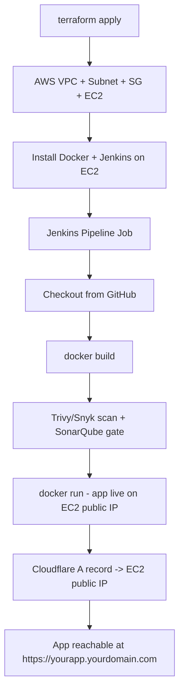

# 08 — End-to-End: Terraform + Jenkins + Docker + Domain + Cloudflare DNS

**Day 8 of the lab — the capstone.** Goal: tie together every previous day into one flow, and make the app reachable via a real domain name instead of a raw IP.

## The full flow



## 1. Provision infrastructure with Terraform

Reuse [`07-terraform-iac/terraform-files/`](../07-terraform-iac/terraform-files/):

```bash
local$ cd 07-terraform-iac/terraform-files
local$ terraform init
local$ terraform apply -var="key_name=<your-key-pair-name>"
```

Note the `instance_public_ip` output.

## 2. Bootstrap the instance (Docker + Jenkins)

Either repeat the manual steps from [`04-docker`](../04-docker/README.md) and [`05-jenkins-cicd`](../05-jenkins-cicd/README.md), or (bonus, recommended if time allows) automate this with Ansible — see [`09-extra-devops-tools/ansible/README.md`](../09-extra-devops-tools/ansible/README.md) for a ready-made playbook that installs Docker + Jenkins in one command against the new IP.

## 3. Configure and run the Jenkins pipeline

Point the `sakec-devsecops-pipeline` job (or a new one) at this repo again, using the Jenkinsfile from Day 5/6 (Git → Build → Scan → Deploy). Run it once manually to confirm the app comes up on port 5000/80 at the new instance's public IP.

## 4. Add a domain to Cloudflare

Official docs: https://developers.cloudflare.com/dns/zone-setups/full-setup/setup/

1. Get a domain (purchase from any registrar, or use a subdomain of a domain you already control).
2. Cloudflare dashboard → **Add a Site** → enter your domain.
3. Choose the **Free** plan.
4. Cloudflare scans existing DNS records, then gives you two **nameservers** (e.g., `aria.ns.cloudflare.com`).
5. Go to your domain registrar's dashboard → update the domain's nameservers to the two Cloudflare ones gave you.
6. Wait for Cloudflare to detect the change (status flips from "Pending" to "Active" — can take minutes to hours).

### For a shared class domain (one domain, many students)

Use subdomains instead of buying one domain per student, e.g.:
- `student1.sakecdevsecops.com`
- `student2.sakecdevsecops.com`

Each is just a separate DNS record pointing at that student's own EC2 public IP.

## 5. Create the DNS record

Official docs: https://developers.cloudflare.com/dns/manage-dns-records/how-to/create-dns-records/

Cloudflare dashboard → DNS → **Add record**:

| Type | Name | Content | Proxy status |
|---|---|---|---|
| A | `@` (or `student1`) | `<EC2_PUBLIC_IP>` | Proxied (orange cloud) or DNS only (grey cloud) |

- **DNS only (grey cloud):** traffic goes straight to the EC2 IP — simplest, matches exactly what we did with raw IPs in earlier days.
- **Proxied (orange cloud):** traffic goes through Cloudflare's network first — gets you free HTTPS/SSL and basic DDoS protection, but adds a layer to explain. Recommended once students are comfortable with the "DNS only" version working.

## 6. Verify

```bash
local$ dig +short yourdomain.com
local$ curl -I http://yourdomain.com
```
Or just open `http://yourdomain.com` (or `http://yourdomain.com:5000` if not on port 80) in a browser.

## 7. (Bonus) Enable HTTPS via Cloudflare

If using the **Proxied** (orange cloud) setting:

1. Cloudflare dashboard → SSL/TLS → set mode to **Flexible** (browser↔Cloudflare is HTTPS, Cloudflare↔EC2 stays HTTP — simplest option, no cert needed on EC2).
2. App is now reachable at `https://yourdomain.com`.

(For a production-grade setup you'd run **Full (strict)** mode with a real certificate on the EC2 instance, e.g., via [Let's Encrypt/Certbot](https://certbot.eff.org/) — worth mentioning as the "next step beyond this lab.")

## 8. Tear down

Once the demo is recorded/graded:
```bash
local$ terraform destroy -var="key_name=<your-key-pair-name>"
```
Remove the Cloudflare DNS record (or just leave it — pointing at a dead IP causes no harm, but it's good hygiene to clean it up).

## Recap: what this capstone demonstrates

- **IaC**: infra is reproducible, destroyable, versioned in Git (Terraform).
- **CI/CD**: every code change can rebuild/redeploy automatically (Jenkins).
- **Containerization**: consistent runtime across environments (Docker).
- **DevSecOps**: security gates built into the pipeline, not bolted on after (Trivy/Snyk/SonarQube/Threat Dragon).
- **Real-world delivery**: a proper domain name and DNS, the way actual products are shipped (Cloudflare).
