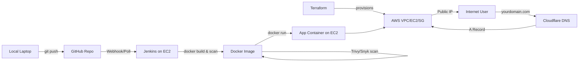

# SAKEC DevSecOps Lab

Hands-on DevSecOps lab for 3rd Year B.Tech (Cyber Security) students at **Shah & Anchor Kutchhi Engineering College**.

This repository is the single source of truth for the lab: concepts, step-by-step installation guides (Windows / macOS / Linux), hands-on exercises, and sample code. Everything is designed to be executed primarily on a single **Ubuntu-based AWS EC2 instance**, with local machine setup (Windows/macOS/Linux) covered wherever students need tools on their own laptop (Git client, SSH, Terraform CLI, AWS CLI, etc).

> Covers the official University of Mumbai DevSecOps Lab syllabus (CO1–CO3, see [`syllabus/`](syllabus/)) **plus** extra industry-relevant tools so students see a realistic, end-to-end DevSecOps workflow.

## Who this is for

3rd year engineering students with basic Linux command-line familiarity, no prior cloud/DevOps experience assumed.

## What you will build, end to end

By the end of the lab, students will have:

1. Launched and secured AWS infrastructure manually, then rebuilt it with Terraform (IaC).
2. Used Git/GitHub for version control on a live, shared repository.
3. Deployed a real application on an EC2 instance, reachable over the public internet.
4. Containerized that application with Docker.
5. Built a Jenkins CI/CD pipeline that pulls code from Git, builds a Docker image, scans it, and deploys it automatically.
6. Applied core DevSecOps practices: image/code scanning, threat modeling, and cloud security hardening (Security Groups, IAM, open ports).
7. Mapped a custom domain to the running application using Cloudflare DNS.

## Repository structure

| Folder | Topic | Maps to syllabus |
|---|---|---|
| [`00-prerequisites/`](00-prerequisites/) | Accounts & local tools every student needs before Day 1 | — |
| [`01-aws-fundamentals/`](01-aws-fundamentals/) | AWS Console, IAM, Networking (VPC/SG), EC2 | CO1 (Module related infra) |
| [`02-git-github/`](02-git-github/) | Git commands, GitHub, branching, live repo workflow | CO1 |
| [`03-sample-app-deployment-ec2/`](03-sample-app-deployment-ec2/) | Deploy a basic app on EC2, expose via public IP | CO1/CO2 |
| [`04-docker/`](04-docker/) | Docker architecture, Dockerfile, images & containers | CO3 |
| [`05-jenkins-cicd/`](05-jenkins-cicd/) | Jenkins install, scripted & declarative pipelines, Maven + Selenium/JUnit | CO2 |
| [`06-devsecops-security/`](06-devsecops-security/) | Trivy/Snyk image scanning, SonarQube SAST, OWASP Threat Dragon, AWS/port hardening | CO3 |
| [`07-terraform-iac/`](07-terraform-iac/) | Infrastructure as Code on AWS with Terraform | CO3 / Micro-project |
| [`08-end-to-end-domain-dns/`](08-end-to-end-domain-dns/) | Full pipeline: Terraform → Jenkins → Docker → domain + Cloudflare DNS | Micro-project |
| [`09-extra-devops-tools/`](09-extra-devops-tools/) | Bonus: Ansible, Prometheus/Grafana monitoring, Selenium+Maven+Jenkins testing | Extra |
| [`schedule/`](schedule/) | Day-wise 8-day teaching plan | — |
| [`syllabus/`](syllabus/) | Original syllabus reference (LLO table & course content) | — |

## 8-Day Plan (short version)

See [`schedule/8-day-plan.md`](schedule/8-day-plan.md) for the detailed hour-by-hour plan.

| Day | Topic |
|---|---|
| 1 | AWS Console, IAM, Networking basics, EC2 launch & SSH |
| 2 | Git & GitHub with a live shared repository |
| 3 | Deploy a basic app on EC2, access via public IP |
| 4 | Docker: containerize the app, build & run image |
| 5 | Jenkins: install & build a CI/CD pipeline (Git → Docker build → Deploy) |
| 6 | DevSecOps: image scanning (Trivy/Snyk), SonarQube, threat modeling, SG/port hardening |
| 7 | Terraform: provision the entire AWS infra as code |
| 8 | End-to-end: Terraform + Jenkins + Docker deployment + domain + Cloudflare DNS mapping |

## How to use this repo in class

1. Fork/clone this repo to your own GitHub account — you will push your work here daily (this *is* your "live repo" exercise for Day 2).
2. Each folder is self-contained: open its `README.md`, follow **Install** steps for your OS, then do the **Lab** steps on the shared EC2 instance.
3. Commands intended to run **on the Ubuntu EC2 instance** are marked clearly with 🖥️ `ec2$`. Commands for your **own laptop** are marked 💻 `local$`.

## Conventions used in this repo

- `ec2$ <command>` → run this on the Ubuntu EC2 instance (via SSH).
- `local$ <command>` → run this on your own laptop (Windows/macOS/Linux).
- Each topic README has three install tracks: **Ubuntu/Linux**, **macOS**, **Windows** — even though the live demo runs on Ubuntu EC2, students should be able to set up tools on their own machines for practice.
- All install instructions link to **official documentation only**.

## License

Educational material for SAKEC students — free to reuse for learning purposes.
